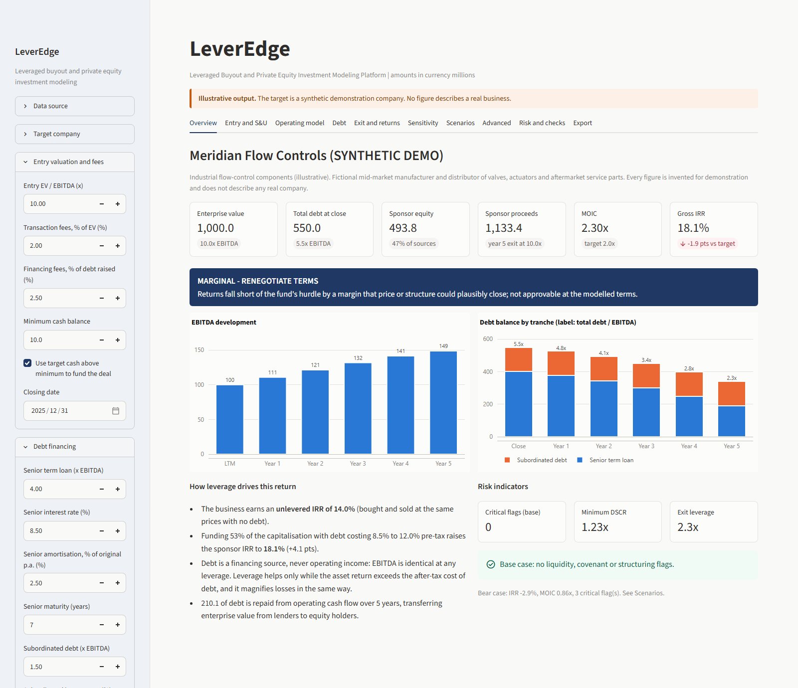
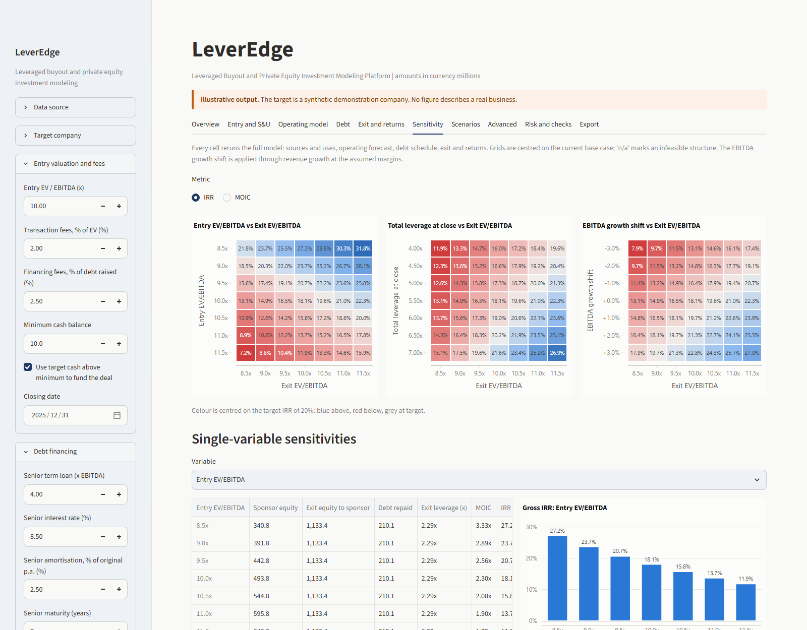
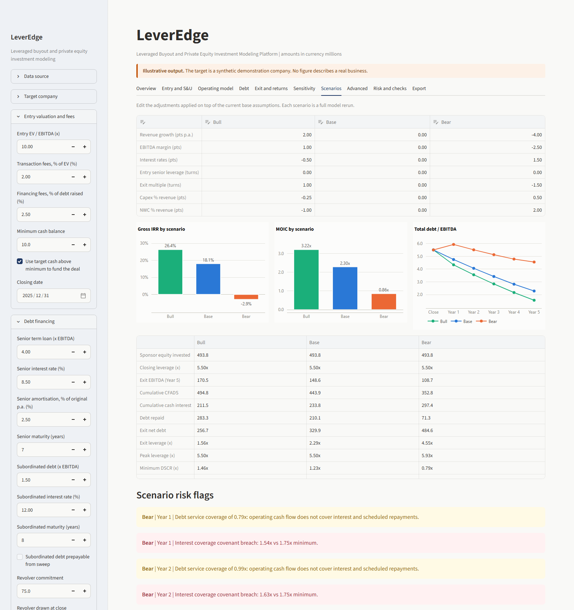
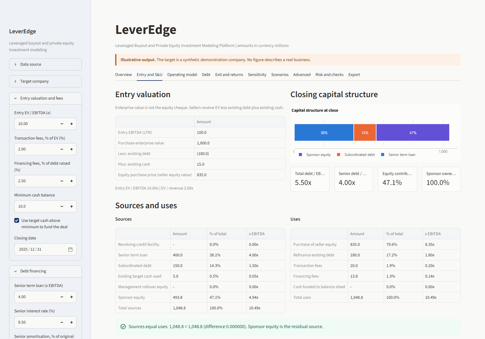
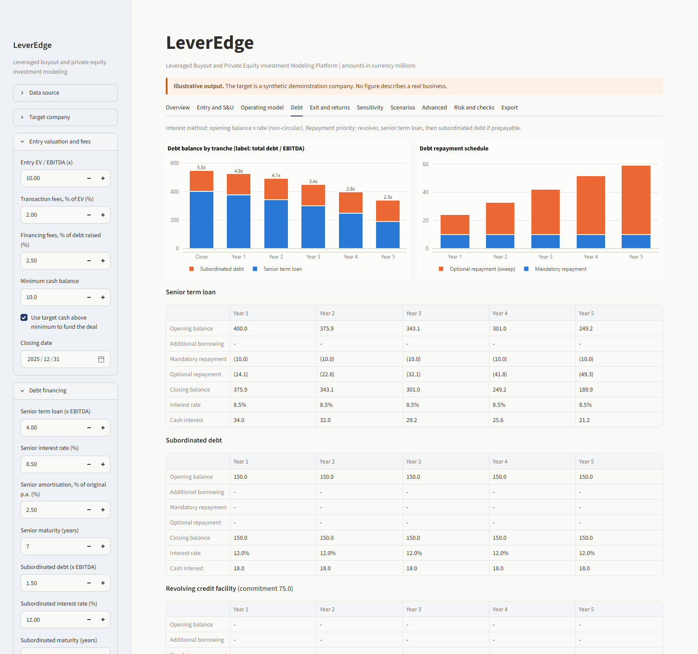
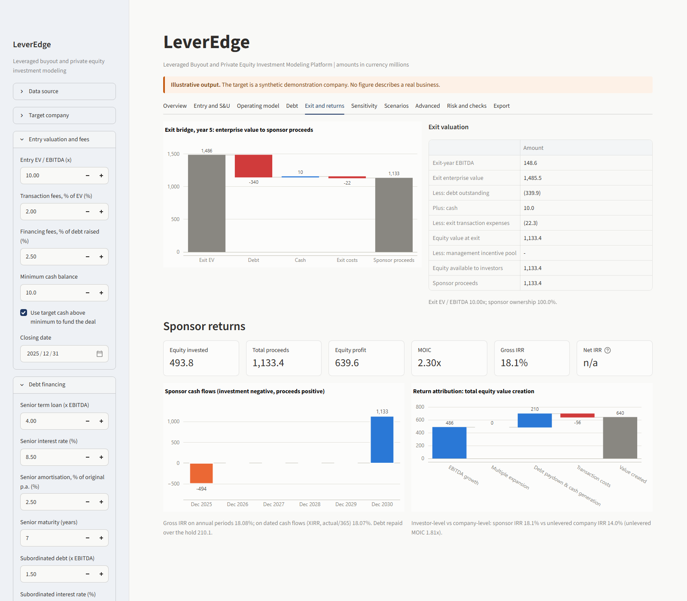
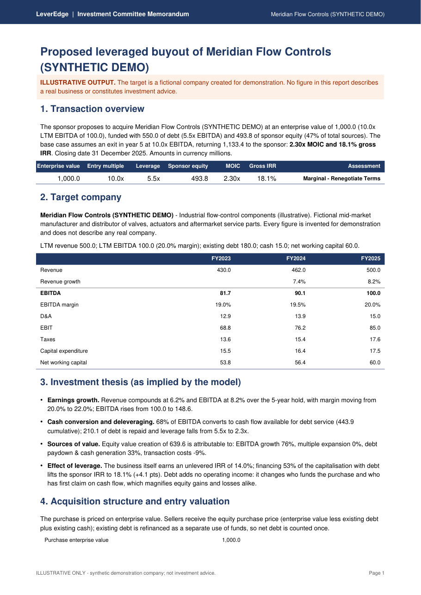

# LeverEdge

**A leveraged buyout modeling platform: from purchase price to sponsor IRR, with every number traceable.**

 [](https://github.com/KartikPawar1411/leveredge/actions/workflows/tests.yml)  

LeverEdge models the acquisition, financing, operation, deleveraging and sale of a company the way a private equity deal team does: a reconciled Sources and Uses table, a three-tranche debt schedule with cash sweep, exit valuation, and sponsor returns. It ships as a Streamlit dashboard, a formula-driven Excel model, and an auto-written Investment Committee memo.



> **The demo company is synthetic.** "Meridian Flow Controls (SYNTHETIC DEMO)" is invented. No figure in this project describes a real company, and nothing here is investment advice.

## Why it is more than an IRR calculator

| | |
|---|---|
| **The model tells you when a deal does not work.** | The demo deal at 10.0x returns 18.1% against a 20% hurdle. LeverEdge rates it "Marginal – renegotiate terms", finds that the bear case breaches its interest-coverage covenant, and solves for the 9.62x entry multiple at which it clears the hurdle. The verdict is computed, never fixed text. |
| **Every sensitivity cell is a full rerun.** | Each heatmap cell rebuilds Sources and Uses, the debt schedule and the exit. Nothing is scaled from the base IRR. A full model run takes about 1.5 ms. |
| **The Excel export is a real model.** | Thirteen sheets, live formulas, banking colour conventions. Recalculated in desktop Excel, its IRR, MOIC and net debt match the Python engine to six decimals. |
| **Problems are flagged, not absorbed.** | Liquidity shortfalls, unfunded maturities, covenant breaches and equity wipe-outs raise explicit flags. Infeasible structures return an error or `n/a`. |
| **Leverage is explained, not assumed.** | The unlevered company-level IRR is reported beside the sponsor IRR, so the contribution of debt is a number (here +4.1 points). |

## Screenshots

| Sensitivity heatmaps | Scenario analysis |
|---|---|
|  |  |

| Sources and Uses | Debt schedule |
|---|---|
|  |  |

| Exit bridge and returns | Investment Committee memo (PDF) |
|---|---|
|  |  |

**Sample outputs** (no install needed): [Excel LBO model](docs/samples/LeverEdge_LBO_Model_demo.xlsx) · [IC report PDF](docs/samples/LeverEdge_IC_Report_demo.pdf)

## Quick start

```powershell
python -m venv .venv
.\.venv\Scripts\python.exe -m pip install -r requirements.txt
.\.venv\Scripts\python.exe -m streamlit run app/main.py
```

On macOS or Linux use `.venv/bin/python`. The app opens at `http://localhost:8501`. Requires Python 3.12 or later.

| Task | Command |
|---|---|
| Run the tests | `python -m pytest` |
| Lint | `python -m ruff check .` |
| Build the demo Excel model and PDF without the UI | `python scripts/generate_outputs.py` |
| Build from a saved assumption set | `python scripts/generate_outputs.py my_deal.json` |
| Recalculate an exported workbook in desktop Excel and print its checks (Windows) | `.\scripts\verify_excel.ps1 output\LeverEdge_LBO_Model_demo.xlsx` |
| Regenerate the README screenshots | `python scripts/capture_screenshots.py` |

Deep links: `http://localhost:8501/?tab=sensitivity` opens a tab directly.

## What the model does

| Area | Implementation |
|---|---|
| Entry valuation | EV = multiple × LTM EBITDA; equity purchase price = EV − existing debt + existing cash |
| Sources and Uses | Sponsor equity is the residual; sources always equal uses; target cash is a source (excess) or a use (top-up), never both |
| Operating forecast | Driver-based (growth, margin) or detailed statement (COGS, SG&A, fixed costs); D&A, capex, NWC, cash taxes |
| Debt | Revolver, senior term loan, subordinated debt; mandatory amortisation, maturities, prioritised cash sweep, minimum cash, commitment cap |
| Interest | Default: opening balance × rate (non-circular). Optional: average balance solved by fixed-point iteration |
| Exit | Exit multiple × exit-year EBITDA, less net debt and exit costs; exit in years 3 to 7 |
| Returns | MOIC, gross IRR (annual periods), dated XIRR, unlevered company-level IRR, return attribution; net IRR only when fund fees and carry are switched on |
| Sensitivities | Seven one-dimensional tables and three heatmaps |
| Scenarios | Bull / Base / Bear with editable adjustments; liquidity, debt-service, maturity and covenant flags |
| Advanced (off by default) | Dividend recap, management rollover, management incentive pool, exit timing comparison, covenants, gross-to-net |
| Assessment | Rule-based verdict from returns, downside resilience and flags, plus the break-even entry multiple |

Every formula is documented in [docs/FORMULAS.md](docs/FORMULAS.md), including a fully hand-calculated reference deal.

## Architecture

```
financials/         typed, validated assumptions; company data loading; errors
transaction/        entry valuation; model.py orchestrates the full run (run_lbo)
capital_structure/  Sources and Uses, closing capital structure
operating_model/    pre-financing forecast
debt/               debt schedule, cash taxes, cash waterfall
returns/            exit valuation, IRR / XIRR solvers, sponsor returns, attribution
scenarios/          Bull/Base/Bear engine, sensitivity engine, exit timing
risk/               risk flags, covenant tests, investment assessment
exporters/          Excel workbook (XlsxWriter), IC report (ReportLab)
app/                Streamlit UI and Plotly charts (presentation only)
tests/              80 pytest tests
```

The engine has no UI imports. One function takes immutable, validated assumptions and returns an immutable result; the dashboard, exporters, scenarios and sensitivities all call it, so there is a single source of truth.

```python
from financials.company import demo_assumptions
from transaction.model import run_lbo

r = run_lbo(demo_assumptions())
print(f"{r.returns.moic:.2f}x  {r.returns.irr:.1%}")   # 2.30x  18.1%
print(all(ok for ok, _ in r.checks().values()))        # True: ten reconciliation checks
```

**Stack:** Python, pandas, NumPy, SciPy (Brent root-finding for IRR/XIRR and break-even price), Streamlit, Plotly, XlsxWriter, ReportLab, pytest, ruff, GitHub Actions.

## Testing and verification

| Item | Status |
|---|---|
| Engine | 80 automated tests pass, including a hand-calculated three-year deal with exact expected balances, taxes, MOIC and IRR, and a sweep over 81 parameter combinations asserting no negative debt and that minimum cash is either held or flagged |
| Directional checks | A higher purchase price lowers returns; higher rates reduce debt repayment; exit equity moves one-for-one with remaining net debt |
| Excel formulas | Recalculated in desktop Excel 16 for the demo and three stress cases (recap, rollover and MIP together; a distressed deal with an unfunded maturity; low leverage). Six outputs matched the engine to six decimals; zero formula-error cells |
| Dashboard | Exercised in a browser; a headless test covers the default render and the infeasible-input path |
| CI | GitHub Actions workflow runs lint, tests and the export build on Ubuntu and Windows, Python 3.12 and 3.13, on every push |

## Excel model

Sheets: Transaction Overview, Assumptions, Historical Financials, Sources and Uses, Operating Model, Debt Schedule, Cash Flow, Exit Valuation, Sponsor Returns, IRR Sensitivity, MOIC Sensitivity, Scenarios, Model Checks.

- Assumptions through Sponsor Returns are live formulas: change a blue input and the model recalculates, including `IRR()`.
- Colour code: blue on yellow = input, black = formula, green = cross-sheet link, purple italic = static engine output.
- Model Checks tests sources = uses, both valuation bridges, non-negative debt, revolver within commitment, minimum cash and attribution, and ties the key outputs to the Python engine.

## Known limitations

- **Excel sensitivity and scenario sheets are static values**, each computed by a full rerun of the Python engine. XlsxWriter cannot author Excel data tables, so these cells do not move when workbook inputs are edited. A live tie-out cell shows when the workbook has diverged from the exported base case.
- **The workbook always uses beginning-balance interest**, including when the app is set to average-balance interest.
- In detailed operating mode the workbook is driven by the implied EBITDA margins, not by COGS and SG&A lines.
- Existing debt is always refinanced at close (no assumed debt).
- Taxes: flat rate on EBIT less cash interest, floored at zero. No NOLs, no interest-deductibility cap, no tax shield from financing-fee amortisation.
- No interest income on cash, no PIK interest, fixed rates, annual periods with a year-end close.
- A liquidity shortfall is flagged, not resolved: the model does not simulate default, waivers or equity cures.
- Net IRR is a deal-level approximation (annual fee on invested equity, carry with full catch-up above a hurdle), not a fund waterfall.
- Developed on Windows with Python 3.15; not yet run on macOS or Linux, or opened in LibreOffice or Google Sheets.

## Documentation

- [docs/FORMULAS.md](docs/FORMULAS.md): every formula, in calculation order
- [docs/INTERVIEW_QA.md](docs/INTERVIEW_QA.md): 25 technical interview questions and answers
- [docs/RESUME.md](docs/RESUME.md): resume bullets and talking points

## License

MIT. See [LICENSE](LICENSE).
